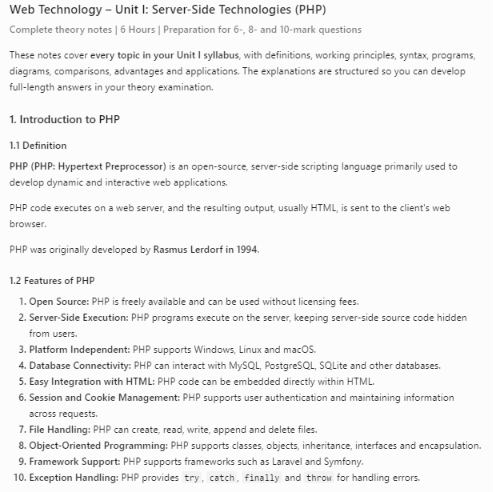
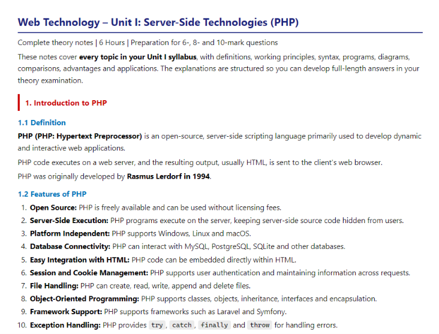
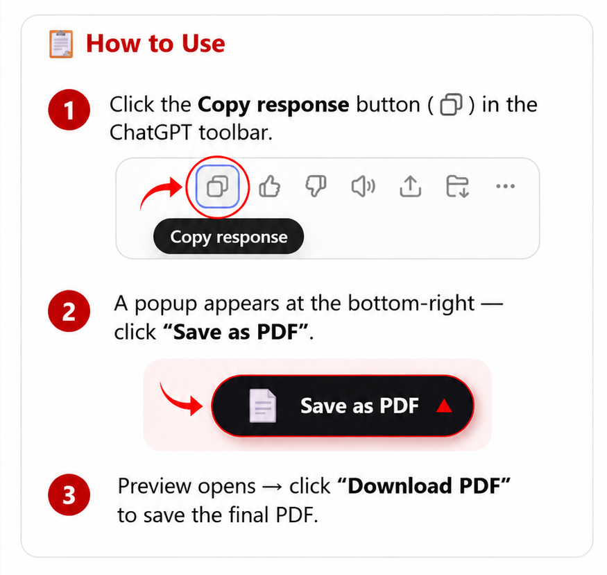

<div align="center">

  

  # Chat2PDF

  **Convert ChatGPT responses into clean, beautifully formatted study notes & PDFs with a single click.**

  [](#-how-to-install-in-chrome)
  [](#-tech-stack)
  [](#-license)

</div>

---

## 📸 Before & After

| ❌ Before (Plain Unformatted Text) | ✨ After (Chat2PDF Study Notes) |
| :---: | :---: |
|  |  |

*Notice the color-coded hierarchy: Dark navy main title (`#1a237e`), red section header with indicator line (`#cc0000`), vibrant blue sub-headings (`#0277bd`), and compact exam-ready line spacing.*

---

## 📋 How to Use

<div align="center">
  
</div>

1. Go to [ChatGPT](https://chatgpt.com) and ask any study or coding question.
2. Click the **Copy response** button (`❐`) or select the text and press <kbd>Ctrl+C</kbd>.
3. Hover over the floating **Save as PDF** button at the bottom-right corner.
4. Pick your mode:
   - **👁️ Preview & Edit:** Review formatted notes, click anywhere to edit text/headings directly, and print or download.
   - **⬇️ Directly Download PDF:** 1-click silent background download straight to your Downloads folder with live status toasts!

---

## 🌟 Key Features

- **⚡ 1-Click Save:** Copy response and hover over the floating button.
- **👁️ Live In-Page Editor:** Click into any paragraph, heading, or code block in the preview tab to edit before saving.
- **⬇️ Silent Background Download:** Download directly without opening any new tabs or leaving ChatGPT.
- **🎨 Structured Study Notes Styling:**
  - **H1 Title:** Dark Navy Blue (`#1a237e`) with clean underline.
  - **H2 Sections:** Bold Red (`#cc0000`) with left indicator accent bar.
  - **H3/H4 Subsections:** Darker Blue (`#0277bd`).
  - **Tables:** Thick border (`2px solid #333`) with subtle alternating row shading.
  - **Code Blocks & Lists:** Monospace font with tight, clean spacing.
- **📄 Perfect A4 Print Layout:** Equalized margins and borderless clean output designed for exam study notes.

---

## 🚀 How to Install in Chrome

1. Clone or download this repository:
   ```bash
   git clone https://github.com/Yog964/Chat2PDF.git
   ```
2. Open Google Chrome and navigate to:
   ```
   chrome://extensions
   ```
3. Enable **Developer mode** using the toggle switch in the top-right corner.
4. Click the **Load unpacked** button (top-left).
5. Select the `Chat2PDF` project folder.
6. The extension is now active on ChatGPT! 🎉

---

## 🛠️ Tech Stack

- **Manifest V3** Chrome Extension architecture
- **html2pdf.js / jsPDF / html2canvas** client-side high-fidelity rendering
- Pure JavaScript, HTML5, CSS3 (zero build steps required)

---

## 📄 License

MIT License © 2026 Yogesh
